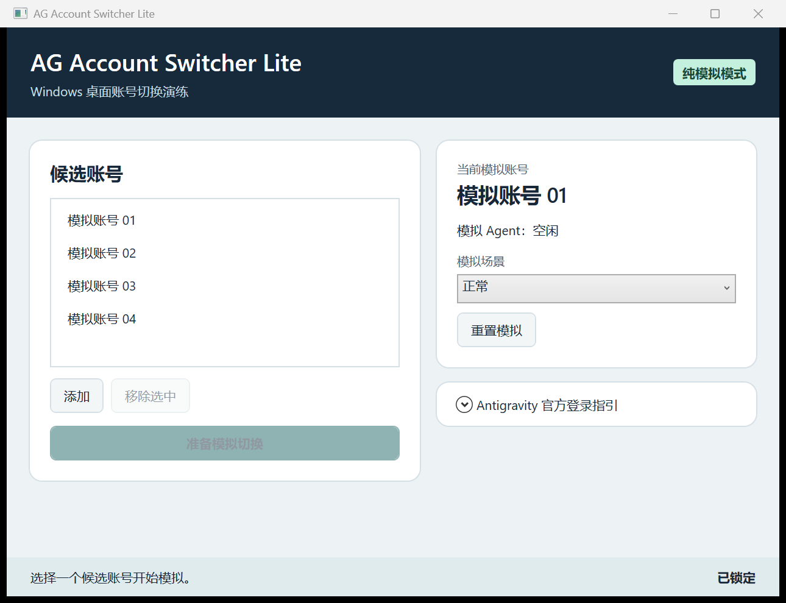

# AG Account Switcher Lite

[简体中文](README.md)

An unofficial Windows 11 x64 desktop utility. Version 0.1.0 provides an offline WPF switch simulation and instructions for using the official Antigravity sign-in flow.

- Start with four simulated accounts. Add and remove candidates for the current run.
- Type a random four-digit confirmation before a simulated switch. The app allows one instance per Windows session and one transaction per instance.
- Exercise busy and unknown Agent states, incompatible versions, authentication failures and restart failures. Reset the simulation to recover.
- Follow the in-app guide to sign out and sign back in manually within the official client and browser.

## Run locally

Follow the [build instructions](docs/development/build.md). To run the extracted Windows x64 ZIP, install the [.NET 10 Desktop Runtime x64](https://dotnet.microsoft.com/download/dotnet/10.0) and open `AGSwitcher.App.exe`. The MVP UI is in Simplified Chinese.

Live automated switching and skipping browser authentication are unavailable. The app does not access credentials, model services or Antigravity data. The four-digit code guards against accidental clicks.

See the [compatibility matrix](docs/research/official-compatibility.md), [feasibility report](docs/research/feasibility-report.md) and [security design](docs/security/design.md).

This independent project is unaffiliated with and has no endorsement from Google.
