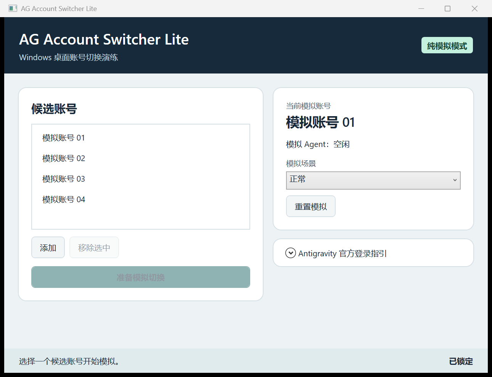

# AG Account Switcher Lite

[English](README.en.md)

AG Account Switcher Lite 是面向 Windows 11 x64 的非官方 Antigravity 账号切换辅助工具。0.1.0 提供离线 WPF 模拟和官方登录指引。

- 默认四个模拟账号，支持添加和移除候选账号。每次启动重新生成。
- 生成随机四位数字防止误触。同一 Windows 会话只运行一个工具实例，每次只允许一个切换事务。
- 演练 Agent 忙碌、身份未知、版本不兼容、认证不可用及重启失败。故障后可显式重置。
- 「Antigravity 官方登录指引」说明如何在官方桌面 App 和浏览器中手动换号。

## 本地运行

1. 按 [构建说明](docs/development/build.md) 编译源码。也可解压 Windows x64 构建产物，安装 [.NET 10 Desktop Runtime x64](https://dotnet.microsoft.com/download/dotnet/10.0) 后运行 `AGSwitcher.App.exe`。
2. 选择候选账号，点击「准备模拟切换」，输入窗口显示的四位数字。
3. 在「模拟场景」改变安全条件，使用「重置模拟」从故障恢复。

## 使用限制

真实自动切换和免浏览器验证当前不可用。应用里的身份、Agent 状态和验证结果均来自模拟后端。工具不访问 Antigravity 认证数据、模型服务或会话文件，也不读取 Google 密码或验证码。

历史记录可见性、打开同一本地项目、跨账号继续对话和不重启切换分别待验。[兼容性矩阵](docs/research/official-compatibility.md) · [可行性报告](docs/research/feasibility-report.md) · [验收记录](docs/development/verification.md) · [安全设计](docs/security/design.md) · [常见问题](docs/faq.md)

本项目独立于 Google，无隶属、授权或背书关系。Google 与 Antigravity 名称用于描述兼容对象。
