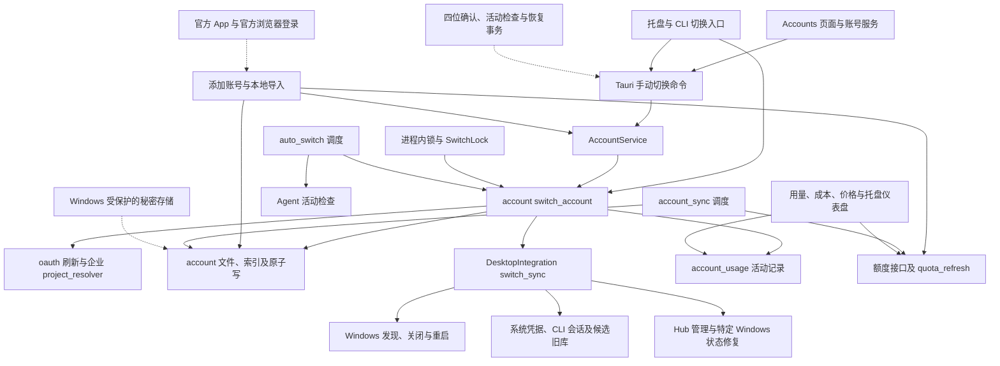

# AG Account Switcher Lite 上游审计与路线决定

审计日期为 2026-11-23（香港时间）。目标为 Windows 11 x64 上的官方 Antigravity 独立 App 2.x，具体基线为本机安装的 2.34.0。初始静态审计覆盖源码、发布记录、授权、恢复、许可证和两个备选项目，未运行上游程序或访问本机账号。获准后的实施和实机证据见「Windows 可运行候选」。

## 结论

**技术上可以从 agy-switch 裁出四账号手动切换程序，当前应将它列为首选技术候选，暂缓确定为正式发布基座。** 它已有真实客户端凭据切换和 Windows 生命周期代码。回访时有条件地省去浏览器，运行中的 App 需要重启。其 Windows 活动任务和登录身份判断、明文凭据、跨存储恢复及 Google 授权边界仍有实质缺口。原始项目文件、原账号切回后看到并续接原对话、其他账号能否看到并续接该对话，是分别需要核验的结果。

若项目需要 OSI 意义的开源许可或商业分发，当前上游许可证是选型硬约束。若允许非商业同许可发布，仍须通过凭据安全、Google 服务使用边界和 Windows 实机验收。原 WPF 模拟原型结束扩展，留作历史研究。

## 首版范围更新：点击账号直接切换

首版只有一个账号列表，最多四个账号。首次在原生 Antigravity App 通过官方浏览器登录，随后将这个已授权账号登记到列表。正常回访时，点击目标账号即发起切换。工具在后台完成安全检查、恢复已保存的授权状态及必要的 App 重启。仍有效的授权应直接回到原生 App，只有授权失效或 Google 要求重验时才引导重新登录。切换成功以 App 中显示目标身份为准。

将「点击账号直接切换」理解为正常流程只有一次点击，因此首版暂缓原先的四位数确认，保留后台防并发、活动状态检查和失败恢复。若 Windows 上无法确认正在运行的 App 可以安全退出，切换停止，用户可在完成任务并正常退出 App 后再点击。项目数据沿用原有目录，切回原账号后应检查旧对话可见性，跨账号续接单独记录，不作为首个快切验证的前置条件。

优先复用 `agy-switch` 的账号登记、真实切换及 Windows 启停中经过审计的部分。上游账号卡已有单击调用 `switchAccount` 的入口。先验证只依赖官方 App 已有的本地授权状态，能否在去掉 Switch 自身 OAuth、明文账号 JSON、自动额度和宽范围导入后完成必要的切换。首版运行范围是单机 Windows 独立 App。额外改写 CLI、IDE 或旧数据库的必要性须按实际版本核对。保存账号使用 Windows 受保护存储，后台使用原有互斥并补上失败恢复。 [上游账号卡](https://github.com/anglee0323/agy-switch/blob/v4.10.18/src/components/accounts/AccountCard.tsx#L307-L321) · [桌面切换入口](https://github.com/anglee0323/agy-switch/blob/v4.10.18/src/pages/Accounts.tsx#L262-L290)

最先验收的是同一台隔离的 Windows 11 上，专用账号经官方登录登记后完成 **A → B → A**。两次切换均只点击一次，不打开浏览器，原生 App 显示正确身份。达到这一条件后再验证四账号、授权失效和恢复场景。Google 只在公开认证文档中为 CLI 明确描述有效系统密钥库凭据的静默登录，尚无面向独立 App 的第三方多账号激活契约。真实账号和系统凭据操作仍等单独批准。 [Google 认证文档](https://antigravity.google/docs/install#local-silent-keyring-sign-in) · [Google Antigravity 附加条款](https://antigravity.google/terms)

本节确定当前首版范围。后文保留上游审计证据与原始较宽的改造估算。

### Windows 可运行候选

在独立克隆 `.local/agy-switch-lite` 的 `codex/windows-lite` 分支从上游 `v4.10.18` 派生，实施提交为 `6d153b3`。Windows 专用 Tauri 程序位于该克隆的 `lite/`，复用上游跨进程锁，裁剪并改造其 Windows 凭据和客户端生命周期路径。普通运行只加载账号列表，保存和回退使用当前用户的 Windows Credential Manager，凭据内容保留在后端。上游宽范围的 CLI、IDE、数据库写入及额度、代理、更新功能没有接入此入口。

首个候选要求先正常退出 Antigravity 及共享认证进程，再点击保存的账号。用户在当前 Windows 上用测试账号反馈可以快速登入，但须手动退出 App。启动原生 App 后，Lite 只能确认原生进程已运行，登录身份须在原生 App 中核对。

Windows x64 Release 构建通过。原生凭据管理器测试使用独立合成条目，结果为 6 通过、0 失败、1 个子进程辅助用例在主测试清单中标记忽略且由互斥用例调用。包含启动失败回退、外部登录状态保护、四账号上限和进程互斥。已启动打包后的程序，核对 WebView2 及固定界面控件。

修订版 `4dd9171ce72fa7726e9100cefc55f3add7840f07` 接入了上游 Windows 正常关闭动作。App 已退出时仍是一次点击。App 已运行且与其不相干的共享认证进程均已退出时，用户核对当前没有活动 Agent 后点「关闭并切换」。仅向已识别的原生 App 窗口请求关闭，所有写入者退出后才继续。普通关闭失败、超时或状态不明时停止切换。没有强制终止进程。

用户在实机上看到上述修订版安全超时。检查发现普通关窗后，Antigravity 仍有已注册的托盘图标和后台进程。用户确认手动完全退出使用的是官方托盘的 Quit，读取已安装 2.34.0 的生命周期代码也确认其调用原生完整退出路径。直接向 Electron 托盘宿主请求菜单的中间尝试未通过 Lite 的实机验收。

首个实现实机单击退出的版本为 `3ce5b9e6d6443d5150f643ea402e492286e4cbd2`。Lite 通过 Windows UI Automation 将键盘焦点限定在系统托盘的 Antigravity 图标，并确认图标属于已识别的 App 进程。只有验证焦点后才发标准上下文菜单键。程序只在对应原生菜单明确显示 `No agents running` 时调用该菜单的 Quit。确认原生 App 和共享写入进程退出后才写入并回读目标授权，随后用原安装路径启动 App。此流程不移动系统鼠标。若读取不到明确空闲状态，或独立共享认证进程仍在运行，程序停止自动退出。

在当前 Windows 11 26H2 x64、Antigravity App 2.34.0，用两个用户登记的测试账号完成槽位 1 → 2 → 1。每次只调用一个账号项，之前的 App 正在运行，旧进程全部正常结束，换号后出现新原生窗口。三次观测分别为 3.6、3.5、3.5 秒，脚本未观察到外部浏览器新增窗口。持久化身份在启动前经过后端回读校验。之后用户实际点击时，Shell 只提供两个旧式无障碍节点，导致找不到托盘图标。使用 Win+B 唤醒通知区域后，可见节点恢复为 33 个，出现了 Antigravity 图标和隐藏图标区的按钮。 [Windows 快捷键](https://support.microsoft.com/en-us/accessibility/windows/keyboard-shortcuts-in-windows)

交付修复版为 `ab8dc8a95201d93d3eedb2318f5c568f9ab1edcc`。图标无法定位时先唤醒通知区域，必要时展开隐藏图标区，无需更改 Windows 任务栏设置。脚本从运行中的 App 单击槽位 2 后，4.7 秒打开新原生窗口，旧进程均退出，未观察到新增浏览器窗口。随后用户在界面实际单击槽位 1，确认 App 自动重开、原生界面显示正确账号，并且浏览器没有打开。Windows 折叠状态的独立诊断和新版用户往返均已验证。隐藏图标区本身可以正常展开并枚举，Antigravity 图标实际位于该区域时的完整切换未单独验收。

Windows Release 构建和打包内容校验通过。原生凭据及窗口回归为 8 通过、0 失败、1 个互斥测试调用的子进程辅助用例。四槽上限、故障回退及进程互斥有合成测试覆盖。官方 `Antigravity.exe` 的 SHA-256 与实施前一致。四账号实机往返和跨账号旧对话连续性未验证。交付包为 [Windows x64 便携版](../../artifacts/agy-switch-lite-windows-x64-r7.zip)，SHA-256 为 `BCF58992BE3DAE2F83421693B4A46163131750D2173F653A95870364BC26905E`。

## 1. Git 现场与审计对象

| 项目 | 已核实结果 |
| --- | --- |
| 原型历史 | `main` 和纠偏分支 `codex/agy-switch-route-audit` 均基于 `db7e6b9bb3994fb9058aa05310244947a1115d32`。本轮创建并切换至纠偏分支。原仓无配置的远程。 |
| 未提交工作 | 六个已跟踪文件原本有未暂存修改，另有 `docs/research/goal-alignment-audit.md` 原本未跟踪。本轮保留原工作树和索引，另备份了 Git 状态、完整 Git 差异及该未跟踪文件。补丁反向验证通过，原未跟踪文件与备份 SHA-256 相同。 |
| 本地证据 | 忽略目录 `.local/route-audit-baseline-2026-11-23/` 中有 `git-state.txt`、`tracked.patch` 和原审计文档副本。克隆目录 `.local/upstream-agy-switch/` 和 `.local/alternative-antigravity-account-switcher/` 各有独立 Git 历史。未创建 GitHub Fork 或发布。 |
| agy-switch 稳定版 | 公开 GitHub 仓库仍有近期发布。Latest 是 2026-11-18 发布的 `v4.10.18`，提交 `815714f9ef431233f663a3c9910071a683de7e5d`。主分支读取于 `f0bb80fd8dec17947dc53d285dd2b6ba633564b5`，稳定标签后仅有文档及 Homebrew 配方更新。`src`、`src-tauri`、前端依赖锁与许可证相同。 |
| 本机与上游平台证据 | 系统注册表为 26H2，构建 `26300.9974`，架构 X64。读取本机安装可执行文件版本资源得到 App `2.34.0`、Google。上游使用 Tauri 2、Rust、React/TypeScript、WebView2 和 Windows x64 NSIS，提供公开安装包和独立 CLI。4.10.18 公开验证记录包含 CI、资产哈希和 PE/NSIS 检查，未对该版本做实体 Windows 安装或真实切换。4.10.17 的 Windows 11 真账号结果是额度刷新和模型显示。4.10.13 的一次真账号往返及同一会话接力是 Mac CLI，App 保持旧身份。 |

[上游仓库](https://github.com/anglee0323/agy-switch) · [v4.10.18 发布](https://github.com/anglee0323/agy-switch/releases/tag/v4.10.18) · [4.10.18 验证](https://github.com/anglee0323/agy-switch/blob/f0bb80fd8dec17947dc53d285dd2b6ba633564b5/docs/maintainers/4.10.18-public-acceptance.md) · [4.10.17 验证](https://github.com/anglee0323/agy-switch/blob/v4.10.18/docs/maintainers/4.10.17-public-acceptance.md) · [4.10.13 实验范围](https://github.com/anglee0323/agy-switch/blob/v4.10.18/docs/release-notes/4.10.13.md) · [官方 App 版本记录](https://antigravity.google/docs/changelog#v2-34-0)

## 2. 真实切换、重启与恢复

1. 桌面 `Accounts.tsx` 的切换按钮把目标固定为 `app`，经 `useAccountStore.switchAccount`、`accountService.switchAccount` 到 Tauri `commands::switch_account` 和 Rust `AccountService::switch_account`，进入核心 **`modules::account::switch_account`**。托盘和 CLI 也能进入相同核心。核心取得进程内和跨进程锁，确认账号存在、按需刷新认证、合并凭据字段，然后调用系统集成。完成后 `finish_switch_account` 才更新活动选择和使用记录。选择记录表达 Switch 当前选择，不能证明 App 已登录该身份。 [桌面入口](https://github.com/anglee0323/agy-switch/blob/v4.10.18/src/pages/Accounts.tsx#L262-L290) · [Tauri 命令](https://github.com/anglee0323/agy-switch/blob/v4.10.18/src-tauri/src/commands/mod.rs#L130-L158) · [切换核心](https://github.com/anglee0323/agy-switch/blob/v4.10.18/src-tauri/src/modules/account.rs#L1018-L1156) · [跨进程锁](https://github.com/anglee0323/agy-switch/blob/v4.10.18/src-tauri/src/cli/switch_lock.rs)
2. **`integration::DesktopIntegration::switch_sync`** 查找运行中的 App、共享认证的 IDE 及候选数据库，关闭原来运行的客户端，再变更认证存储，最后重启之前在运行的客户端。Windows 先向已识别窗口请求正常关闭，超时会强制终止剩余匹配进程。App 原先关闭时，核心写完后不会自行启动它。上游另有只更新共享凭据的路径，已运行 App 会继续使用内存里的旧身份直到重启。Windows 下 App 主进程无需重启即可实际换号，当前没有证据。 [系统集成](https://github.com/anglee0323/agy-switch/blob/v4.10.18/src-tauri/src/modules/integration.rs#L51-L185) · [Windows 关闭代码](https://github.com/anglee0323/agy-switch/blob/v4.10.18/src-tauri/src/modules/process.rs#L456-L487)
3. 默认 App 目标涉及当前 Windows 用户的 Antigravity 通用凭据和已初始化的 `agy` 会话。若找到作用域内的旧式数据库和相邻设置，则还可能写 OAuth/设备数据，并生成数据库备份。IDE 自身版本达到 2.6 且被识别时也可共享 App/CLI 登录并随之关闭重开。正常链路沿用原有数据环境，没有按账号复制项目目录、移动会话或修改官方 App 二进制。上游实验性翻译另有客户端运行时注入入口，必须从 Lite 移除。 [上游账号范围](https://github.com/anglee0323/agy-switch/blob/v4.10.18/docs/account-scopes.md) · [写入范围](https://github.com/anglee0323/agy-switch/blob/v4.10.18/src-tauri/src/modules/integration.rs#L187-L219) · [实验功能](https://github.com/anglee0323/agy-switch/blob/v4.10.18/docs/app-experiments.md)
4. **已有防护与恢复。** 刷新失败通常在关闭/写官方客户端前报错。关闭失败会阻止后续写入。原子文件替换及回读保护局部文件。某些旧库有独立备份。Windows 已知状态损坏有专门处理，仅对默认路径、非空且不超过 16 MiB 的全零文件，在符合条件时保留原件并移动为备份，由原生 App 下次启动重建。此措施未覆盖一般状态损坏或账号事务。 `update_client_credentials` 在尝试写入后也会尝试重启已观察到的 Hub，Windows 的 Hub 枚举实现目前返回空列表。 [文件原子写](https://github.com/anglee0323/agy-switch/blob/v4.10.18/src-tauri/src/utils/fs.rs#L55-L131) · [Windows 状态修复](https://github.com/anglee0323/agy-switch/blob/v4.10.18/src-tauri/src/modules/app_state_recovery.rs#L67-L119) · [Hub 平台实现](https://github.com/anglee0323/agy-switch/blob/v4.10.18/src-tauri/src/modules/app_hub.rs#L51-L139)
5. **跨存储有失败窗口。** Windows 代码先删原系统条目再写新条目，写失败会直接返回。后续 CLI 文件、数据库、客户端启动或索引更新失败，也可能只完成前半段。上游没有贯穿存储提交、重启和身份核对的回滚。Windows `agent_activity::running()` 恒为 `Unknown`，`app_identity::running_email()` 返回 `None`。手动切换本身也未使用自动切换调度器的任务门槛，单看进程、凭据或 Switch 的索引无法验证客户端身份或 Agent 空闲。 [Windows 写入和 CLI 同步](https://github.com/anglee0323/agy-switch/blob/v4.10.18/src-tauri/src/modules/integration.rs#L303-L394) · [Microsoft 凭据替换语义](https://learn.microsoft.com/en-us/windows/win32/api/wincred/nf-wincred-credwritew#remarks) · [任务探针](https://github.com/anglee0323/agy-switch/blob/v4.10.18/src-tauri/src/modules/agent_activity.rs#L149-L194) · [运行身份探针](https://github.com/anglee0323/agy-switch/blob/v4.10.18/src-tauri/src/modules/app_identity.rs#L198-L205)

## 3. 凭据专项安全审计

| 优先级 | 源码证据与影响 | Lite 的准入条件 |
| --- | --- | --- |
| 高 | 添加账号可由 Switch 打开 Google 浏览器页面。它登记自身的回调窗口、收取授权码，并自行换取 OAuth token，支持内置及可配置的 OAuth 客户端。回环回调检查 state 且有超时。未找到 PKCE，另有手动提交授权码入口，提交 API 的 state 可空。该实现无法证明 Google 许可第三方接管官方客户端登录。此外，上游可从官方本地凭据导入并向 Google 验证。 | 首次与需要重新验证时由官方 Antigravity App 发起并处理完整浏览器登录，去掉第三方授权码、token 粘贴和自有 OAuth 客户端入口。若 Google 明确允许保存既有官方状态，再评估用户主动登记当前会话的最小接入。 |
| 高 | `.antigravity_tools/accounts/<id>.json` 以 `serde_json` 直接存序列化 `Account`，其 `TokenData` 包含 access、refresh 及可选 ID token。索引另存 `accounts.json`。Windows Credential Manager 保护写给官方 App 的活动条目，但 Switch 自己保存的账号 JSON 没有应用层静态加密。已初始化的 CLI 会话、候选数据库备份也可能含凭据。导出代码含 refresh token。 | Switch 自有秘密采用当前用户的 Windows Credential Manager 或用户级 DPAPI。普通配置和恢复记录仅存别名、ID、状态及秘密引用。移除凭据导入/导出兼容入口，单独审查和处理已有明文数据。禁止对本项目用户真实数据主动迁移。 |
| 高 | `list_accounts`、`get_current_account` 和登录等接口返回完整 `Account`，可把 `TokenData` 带入 Tauri WebView。错误分支把若干服务器原始响应体拼进返回值，现有日志含邮箱与账号 ID。正常审查路径未发现明确输出 token 原文，但无凭据离开 Rust 边界或任意错误不泄露的保证。 | 密钥只驻留在后端与获准的操作系统存储。对 IPC 返回字段、前端 console、持久日志、诊断及网络错误逐层使用允许列表，以合成秘密做日志与 IPC 泄漏测试。 |
| 高 | Windows 先删后写活动凭据，多个后续写点与重启没有总事务。窗口关闭超时可强制结束进程，Windows 无可信活动任务探针。自动同步调度虽默认关闭，开启后可读取和导入观测到的身份，并刷新额度。 | 移除强制结束和后台凭据导入。状态未知则不执行切换。使用跨进程事务边界、受保护的最小恢复数据和下次启动可识别的恢复状态。恢复失败时停止后续操作，由官方 App 完成重登。 |
| 中 | 已审路径中，认证/令牌请求发往 Google，未发现向非 Google 服务上传凭据的路径，也未发现模型反代入口。上游还有报价、汇率、更新检查、系统/手动代理及实验功能。上游 Windows 安装包没有 Authenticode 签名。 | 核心默认只使用官方 App 自身联网，阻断额度、统计、价格、实验与上游自动更新。发布前对实际产物、依赖、网络和进程行为做检查。 |

没有看到保存 Google 密码或 Google 验证码的标准登录流程。Google 浏览器页面只表示 Google 执行用户授权。由谁接收 OAuth 授权码、谁保管和刷新凭据、是否允许第三方复用，是另外三项条件。Google OAuth 政策也要求保护并加密静态 token。 [OAuth 实现](https://github.com/anglee0323/agy-switch/blob/v4.10.18/src-tauri/src/modules/oauth.rs#L320-L436) · [回调](https://github.com/anglee0323/agy-switch/blob/v4.10.18/src-tauri/src/modules/oauth_server.rs) · [账户文件写入](https://github.com/anglee0323/agy-switch/blob/v4.10.18/src-tauri/src/modules/account.rs#L739-L768) · [凭据模型](https://github.com/anglee0323/agy-switch/blob/v4.10.18/src-tauri/src/models/token.rs) · [IPC](https://github.com/anglee0323/agy-switch/blob/v4.10.18/src-tauri/src/commands/mod.rs#L7-L34) · [Google OAuth 政策](https://developers.google.com/identity/protocols/oauth2/policies#handle-user-tokens-securely) · [Microsoft DPAPI](https://learn.microsoft.com/en-us/windows/win32/api/dpapi/nf-dpapi-cryptprotectdata)

## 4. 浏览器、项目和官方合规

| 问题 | 证据与结论 |
| --- | --- |
| 每次要开浏览器吗 | 官方个人账号换号路径是退出后重新登录，App 打开浏览器完成 OAuth。重新选择账号、再做一次密码/通行密钥验证是不同事件。上游回访切换使用已保存授权，凭据有效或可成功刷新且原生 App 接受时，源码执行路径不要求每次开浏览器。授权撤销、策略要求重验、令牌失效或认证格式变化时，需要回到官方浏览器流程。Windows 11 + App 2.34.0 的实际成功率和验证频率没有测量。 |
| 能保留项目和继续旧对话吗 | 上游以同一 Windows 用户与官方 App 数据环境工作，不换项目目录，正常切换未见迁移或删除对话的步骤。原目录可重新打开有技术依据。同一项目仍出现在原生 App、原账号切回来能看到并续接原对话、另一个账号能打开并继续该对话，都暂无本机实测或公开协议保证。Mac CLI 接力证据不能外推。云端项目、远程任务和其他账号资源按 Google 授权处理。 |
| 同一时间只有一个账号吗 | 后端可用唯一交易和唯一活动槽约束本工具。上游明确说明已经运行的 `agy` 可保留旧身份，IDE 也可能共享认证。Windows App 重启且人工核对账号属于可验收范围。现存 CLI/Hubs、远程任务、其他设备或进程不受本工具统一控制，活动状态不能确定时应停住。 |
| 已确认官方支持 | 原生 App 发起浏览器 OAuth、原生退出与重登、本机的 App/CLI/IDE 等认证面共享，以及用原生 Projects 打开本地目录。公开文档未提供 Windows App 的第三方四账号预授权切换契约。 |
| 技术可行但许可未确认 | 以第三方工具替换本地认证记录并由官方 App 使用目标身份。Google 没有在查到的公开资料中明确许可该行为。第 6 条范围较广，当前实现还直接使用 OAuth token 向 Google 换新凭据和调用服务，因此不能把上游原样复用视为合规。把备份改为 Windows 密钥库也不能解决这项服务许可。 |
| 官方明确限制 | Antigravity 附加条款第 6 条将用第三方软件访问服务列为违约，并以第三方代理/工具复用 Antigravity OAuth 为例。FAQ 表明 consumer 计划不支持自动轮换或把 CLI 包装到第三方编码代理/应用。Google 通用条款限制绕过保护措施。本项目排除自动轮换、额度池、并行账号和模型 API 反代。 |

[官方认证](https://antigravity.google/docs/install) · [官方换号指引](https://antigravity.google/docs/workspace#option-1-use-a-personal-google-account) · [官方 Projects](https://antigravity.google/docs/projects) · [官方 Remote Agents](https://antigravity.google/docs/remote-agents) · [Antigravity 附加条款第 6 条](https://antigravity.google/terms) · [Antigravity FAQ](https://antigravity.google/docs/faq) · [Google 通用条款](https://policies.google.com/terms)

## 5. 依赖图与精简清单

下图实线是现有调用关系，虚线标明拟保留功能必须新增或替换的边界。

托盘在不同入口既可调用 Tauri 命令，也有前端调用。CLI 部分路径直接调用核心。两者现在提供绕过未来四位确认的入口，Lite 首版应先撤掉这些写入路径。

| 动作 | 文件与依赖处理 |
| --- | --- |
| 保留 | 复用 `src/pages/Accounts.tsx`、`src/components/accounts/` 的基本列表、增删和备注，缩减 `src/services/accountService.ts`、`src/stores/useAccountStore.ts`。Rust 保留 `commands/mod.rs`、`modules/account_service.rs`、`modules/account.rs` 的账号与手动切换骨架，`cli/switch_lock.rs` 的跨进程互斥、`utils/fs.rs` 的原子写和 Tauri 单实例机制。沿用 `modules/process.rs`、`process/windows_close.rs`、`modules/version.rs` 经过复核的 Windows App 识别与优雅关闭/启动。 |
| 修改 | 在唯一后端切换命令加随机四位数字、目标与本次请求绑定、一次性验证、过期取消和四槽上限。后台核对系统用户、版本、目标进程、任务状态和残留写入者。保留已获准的 `integration.rs` 最小写入边界，限定 App 与不可避免的共享面，Windows 禁用强杀。将明文 `models/account.rs` / `models/token.rs` 持久化及 IPC 改为受保护的秘密引用和精简摘要。将 `app_state_recovery.rs` 的损坏检测保留为兼容研究，首版正常切换禁止自动重命名 App 状态，另做可恢复事务。 |
| 有条件替换 | `oauth.rs`、`oauth_server.rs`、`migration.rs` 的现有自动换取、刷新、扫描和宽范围导入不能原样发布。保留账号添加界面的交互，由官方 App 发起登录。只有在得到 Google 对本地登记和复用路径的明确许可后，才选择所需的最窄适配器。`db.rs`、`device.rs`、`cli_credentials.rs`、`app_hub.rs` 逐一证明在 Windows 2.34.0 上的依赖关系，只保留经验证且获准的部分。企业 `project_resolver` 仍被现有核心引用，先明确 Lite 只面向个人账号，再拆企业路径。 |
| 禁用后移除 | 先断 `lib.rs` 启动及 IPC 的 `auto_switch`、`quota_refresh`、`account_sync`、`app_experiments`，移除 `cli/mod.rs`、`cli/picker.rs`、`cli/workflows.rs` 与 `tray.rs` 的切换路径。再移除 `quota.rs`、`account_dashboard.rs`、`account_usage.rs`、`native_token_stats`、`menu_bar_usage.rs`、`api_pricing.rs`、`app_transport.rs`、实验翻译及配套前端页面、计时器和配置。删除上游更新源、更新公钥与发布绑定，收紧 Tauri capabilities。 |
| 拆除前须检查 | `commands/mod.rs` 的登录、导入和同步可直接触发额度刷新，即使已停定时器。`account_sync` 与账号服务的批量额度刷新使用 `quota_refresh::SingleFlight`。`finish_switch_account` 记录 `account_usage` 活动。`auto_switch` 的测试夹具有复用 `account.rs` 合并逻辑的测试。先剪调用边、迁移仍必要的同步原语和测试，再删模块，防止只移除菜单却留后台路径，或直接删依赖导致切换失效。 |

[Tauri 启动和注册](https://github.com/anglee0323/agy-switch/blob/v4.10.18/src-tauri/src/lib.rs#L234-L356) · [登录及同步命令](https://github.com/anglee0323/agy-switch/blob/v4.10.18/src-tauri/src/commands/mod.rs#L346-L575) · [后台同步](https://github.com/anglee0323/agy-switch/blob/v4.10.18/src-tauri/src/modules/account_sync.rs) · [额度调度](https://github.com/anglee0323/agy-switch/blob/v4.10.18/src-tauri/src/modules/quota_refresh.rs)

## 6. 许可证、备选与 GitHub 路径

**agy-switch 的代码许可证是 CC BY-NC-SA 4.0。** 上游 `LICENSE`、README 与 Rust 包元数据一致。它允许符合许可的非商业修改和共享，发布衍生版本需要保留提供的署名、版权、许可证及免责通知，链接上游并标明改动，采用同要素或认可的兼容许可。该许可不授予商标或专利权，商业用途需另取必要权利。非商业限制不符合 OSI 开源定义。原 WPF 仓库用 MIT，不能用该 MIT 许可替代 AGY 上游衍生代码的条款。上游注明来源为 `lbjlaq/Antigravity-Manager`，发布前还需检查素材、依赖和版权链相关通知。 [上游许可证](https://github.com/anglee0323/agy-switch/blob/v4.10.18/LICENSE) · [上游来源署名](https://github.com/anglee0323/agy-switch/blob/v4.10.18/README.md#development) · [CC 许可正文第 2、3 条](https://creativecommons.org/licenses/by-nc-sa/4.0/legalcode.en) · [OSI 开源定义](https://opensource.org/osd)

| 选择 | 技术与许可比较 | 取舍 |
| --- | --- | --- |
| `anglee0323/agy-switch` | 近期稳定版与持续发布流程，Windows 真实路径详细，源码和测试证据最完整。接管凭据的范围较广，Windows Agent 和总事务有缺口。许可为非商业同方式共享。 | 非商业且 Google 明确支持经审计路径时，作为优先衍生候选。 |
| `mohammedjaferalshouha/antigravity-account-switcher` | 核查了 MIT `v1.1.1` / `6285d9c0254a03bb98da516ab24e148ce91170f7` 单提交源码。独立 Windows WinForms 工具，引导在官方 App 内登录，账号副本使用 Windows Credential Manager，不见等价的明文 JSON token 库。`AccountOperations.LaunchAccount` 关闭后复制目标凭据并启动 App。添加过程有恢复尝试，普通切换未见相同保障及目标身份确认，存在强制结束进程的路径。 | 许可和最小范围更贴合，成熟度与 App 2.34.0 兼容性仍待验证。复制官方凭据依旧需要确认 Google 许可。 |
| `ismaelsoilet/antigravity-account-switcher` | MIT。仓库文档说明它以 IDE 扩展及 CLI 为中心，保存明文 OAuth vault 及副本，并同步多个 token 文件及数据库。公开资料称失败时可恢复此前状态，这项比较未独立验源码或运行。 | 同时扩大凭据暴露面和修改面，当前不优先。 |
| 官方 App 手动换号 | 公布了个人账号用官方浏览器换号的流程，本仓已有用户亲自完成 A → B → A 的历史记录。重复浏览器、点击和验证频率按真机测量。 | 作为真实体验和兼容性对照。第三方快切未经允许时，采用官方路径仍能进行对照验收。 |

[MIT Windows 备选源码](https://github.com/mohammedjaferalshouha/antigravity-account-switcher/blob/v1.1.1/AntigravityAccountSwitcher.cs#L742-L847) · [备选许可证](https://github.com/mohammedjaferalshouha/antigravity-account-switcher/blob/v1.1.1/LICENSE) · [IDE 扩展凭据说明](https://github.com/ismaelsoilet/antigravity-account-switcher#security--data) · [原型里的官方手动往返记录](../development/verification.md#2026-11-23-官方-app-轻量换号)

建议在现有原型仓库保存审计和决策，走独立克隆验证。只有许可和准入条件确立后，再在 GitHub 创建保留上游祖先历史的独立 Fork 或衍生仓，固定初始 tag 与完整 SHA，设独立 `upstream` remote 和自身 `origin`，在仓内列出来源、改动及第三方通知。禁用继承的自动发布工作流和上游更新源。后续审阅 Windows 兼容与安全补丁，按功能 cherry-pick 或在隔离分支合并，在发布前复跑验收。真实端安全准入和发布许可均独立于 GitHub 是否允许 Fork。 [GitHub Fork 文档](https://docs.github.com/en/pull-requests/reference/forks) · [GitHub 许可文档](https://docs.github.com/en/repositories/managing-your-repositorys-settings-and-features/customizing-your-repository/licensing-a-repository)

## 7. 最小改造与验收计划

1. **先过准入。** 明确预期分发用途与许可证。向 Google 确认第三方本地授权状态复用和原生 App 后续访问服务的边界。确认能否使用获准的 Windows 身份、活动检测和最小凭据适配。没有对应许可证据时，快切路径保持冻结，不安排真实账号试验。
2. **裁剪入口和界面，约 1–2 个工作日。** 独立 Tauri 衍生分支。关闭多余后台及 Invoke 入口，建立四个账号槽、单一活动状态、随机四位确认与进程互斥。切换开始前先看目标版本及用户，若 App、CLI、IDE 或 Hub 仍在运行且活动不明，要求用户在原生 Overview、终端和任务入口确认后正常退出，再重新检查可见进程。若有可能受影响的云端任务且状态无法确认，暂停切换。只在独立测试数据上构建和验证。
3. **加固切换与恢复，约 3–5 个工作日。** 在许可允许的路径中保留真实切换核心，前置验证目标状态、可写性与恢复条件。恢复记录不含明文秘密。分阶段保护旧状态并记录写入、原生启动、身份核验和提交结果。失败后按已完成阶段恢复并验证原账号，无法证明恢复时保留安全停止态并引导官方重登。一般退出超时即停止，严禁强杀 Agent。用临时合成数据覆盖断电式中止、第二进程、写失败、重启失败、身份未知、四槽上限和日志泄漏。仅经验证必要时保留 App 所需的共享写点。
4. **独立 Windows 真机验证，约 2–4 个工作日。** 需单独批准且使用专用测试账号及隔离 Windows 用户/虚拟机。先用两个账号对照官方换号，再验证四账号回访及拒绝添加第五个账号。正式切换须核对官方 App 显示身份，记录切换时间、是否打开浏览器、是否出现账号选择和是否重复验证。验证两组原目录、同一项目在 App 中的可见性、切回原账号继续原对话，以及另一账号访问原对话的边界。运行 Agent、自动化、残留 CLI/Hub、过期授权、进程或存储故障各做一次阻止/恢复场景。验收目标是比同机原生手工流程更少交互并可靠恢复。若对话无法续接，报告具体失败层及范围。
5. **整理 Windows 打包与发布准备，约 1–2 个工作日。** 锁定源码和依赖，验证当前用户安装、无后台额度及用量请求、官方客户端安装文件哈希一致、卸载不动官方数据，记录产物大小与常驻开销，准备作者署名、第三方声明、SHA-256 和签名路径。发布单独审批。

条件具备时，单人估计 **7–13 个工作日**，Google 答复、签名获取及真实账号审批等待不计。最大的未知量是 Windows 2.34.0 授权复用是否获准、需写哪些共享状态，以及退出重启后项目和原对话是否能继续。本轮工作到源码与条款审计止，真实账号阶段暂停。
